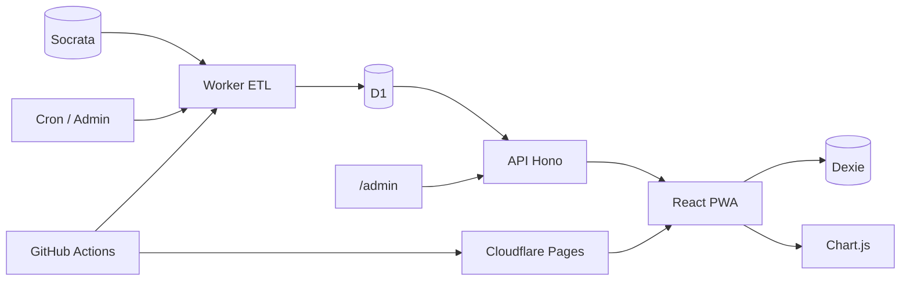
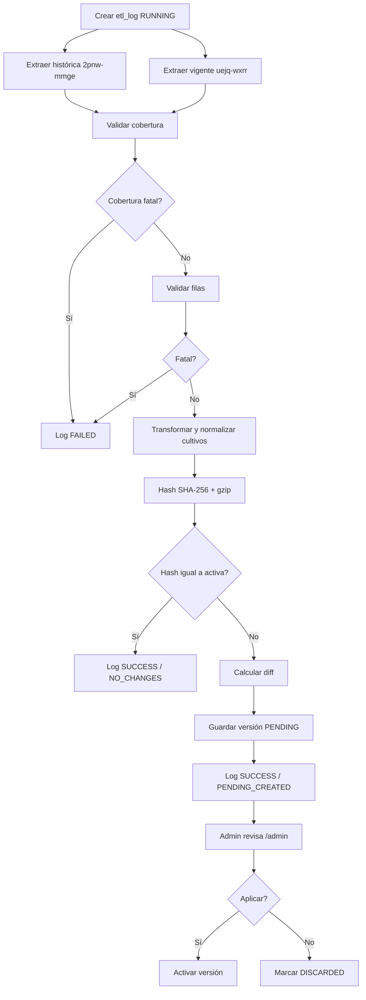
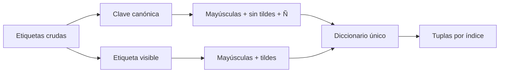
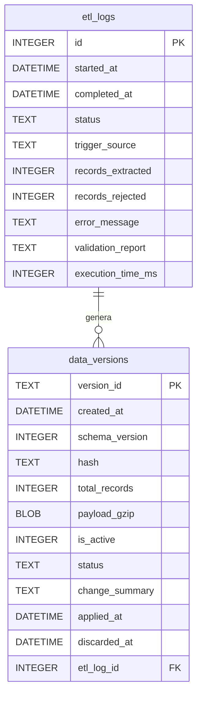
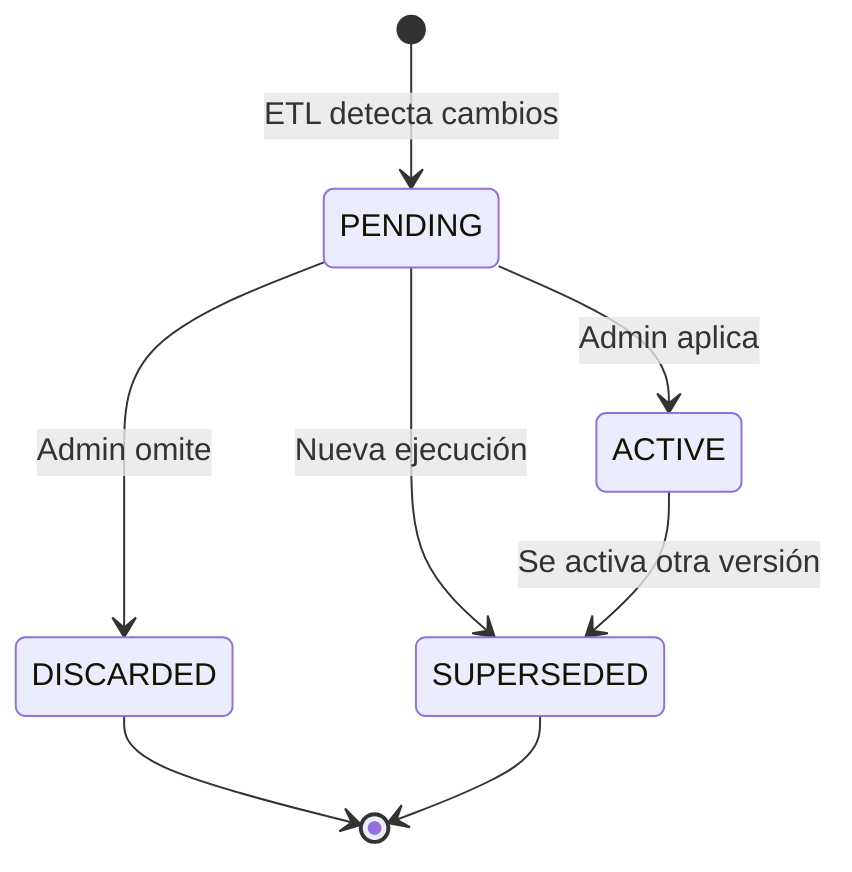
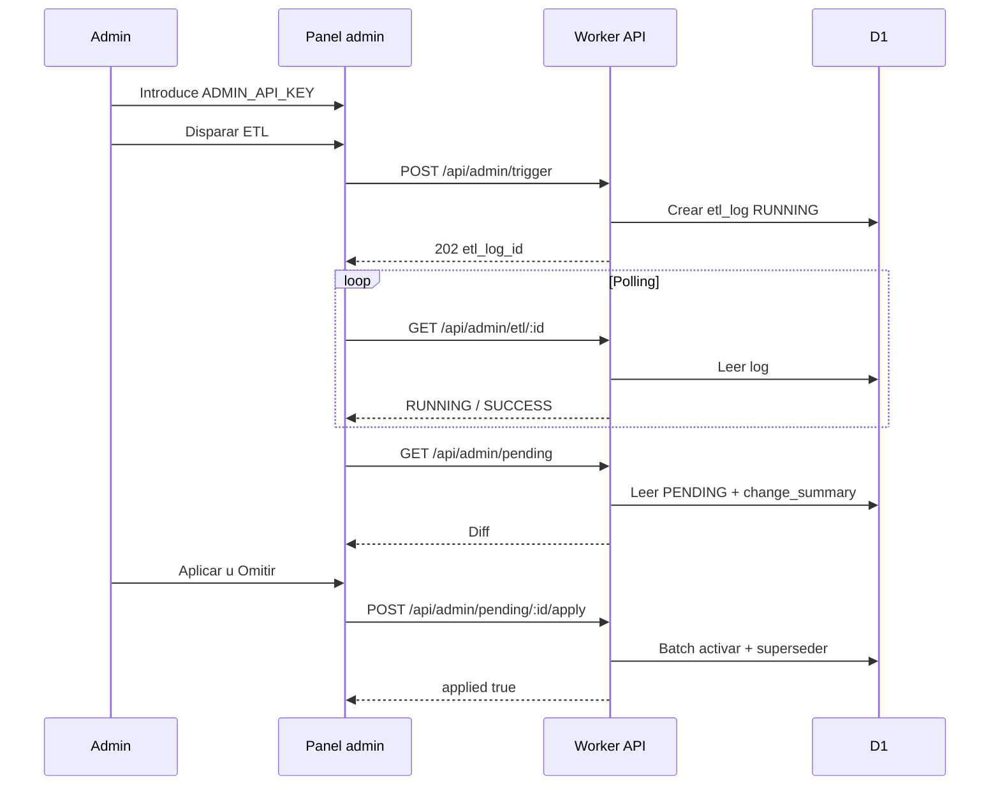
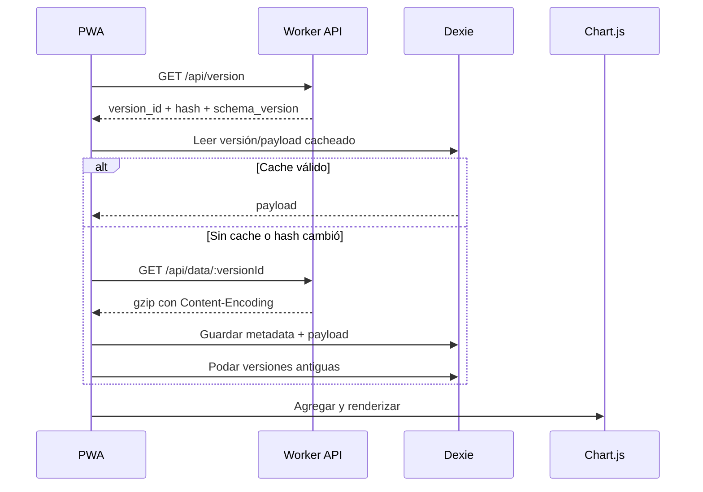
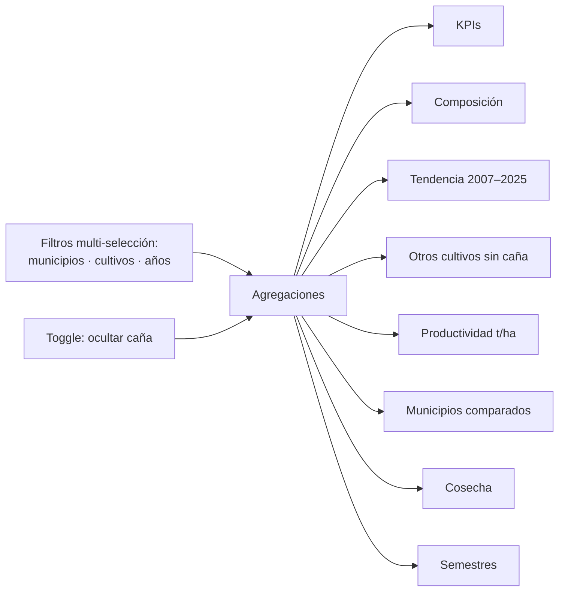
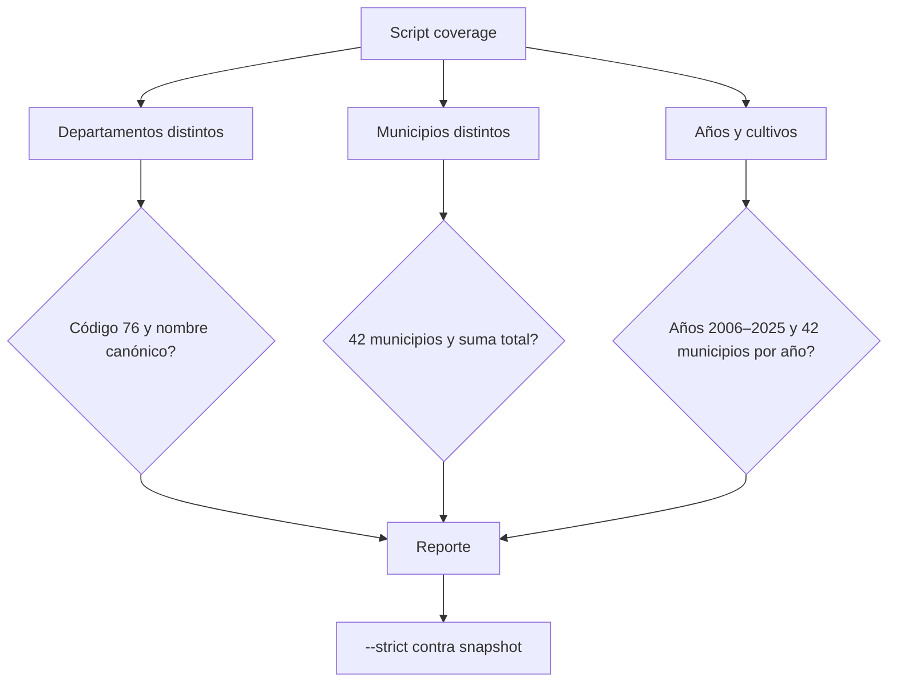
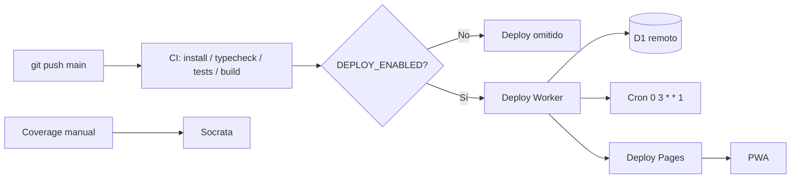

# Arquitectura de AgroDatos

## Stack utilizado

| Capa | Tecnología | Uso |
|---|---|---|
| Backend | Cloudflare Workers | Ejecución en el Edge |
| Framework API | Hono | Rutas públicas y admin |
| Base de datos | Cloudflare D1 | Logs, versiones y payload gzip |
| Frontend | React 19 + Vite | PWA y panel admin |
| Estado remoto | TanStack Query | Consultas y caché |
| Estado offline | Dexie.js | IndexedDB local |
| Gráficas | Chart.js + react-chartjs-2 | Visualización agregada |
| PWA | vite-plugin-pwa + Workbox | Instalación y offline |
| Tipos | TypeScript + `@agrodatos/shared-types` | Contratos compartidos |
| Pruebas | `node:test` + `--experimental-strip-types` | Unitarias y smoke |
| Monorepo | pnpm workspaces | Frontend, Worker y tipos |
| CI/CD | GitHub Actions | Checks, deploy y cobertura |
| Hosting | Cloudflare Pages + Workers | Frontend y API |

## Fuentes de datos

| Fuente | Dataset | Nacional | Valle | Años |
|---|---|---:|---:|---|
| Histórica EVA | `2pnw-mmge` | 206.068 | 15.774 | 2006–2018 |
| Vigente EVA | `uejq-wxrr` | 166.732 | 10.589 | 2019–2025 |
| Total | | 372.800 | 26.363 | |

El filtro es siempre `c_d_dep=76` o `c_digo_dane_departamento=76`. No se procesan otras regiones.

## Arquitectura general



## Flujo ETL y aprobación



### Normalización de cultivos



- Clave: `CAFE`, `MAIZ`, `TOMATE DE ARBOL`.
- Etiqueta: `CAFÉ`, `MAÍZ`, `TOMATE DE ÁRBOL`.
- Se unifican variantes como `CAFE`/`Café` y `REPOLLO`/`Repollo`.

## Modelo de datos



Estados de `data_versions.status`:



## Aprobación manual



Reglas:

- Solo una versión `PENDING` a la vez.
- Una nueva ejecución marca la pendiente anterior como `SUPERSEDED`.
- Si un hash fue omitido, no se vuelve a proponer.
- `?force=true` permite forzar una nueva comparación.
- La versión activa no cambia hasta que el admin aplica.
- La fuente tiene 1.640 registros con clave repetida; el diff los empareja por valores y las gráficas los agregan.

## Sincronización offline



Estrategias PWA:

- `NetworkFirst` para `/api/version`.
- `CacheFirst` para `/api/data/*`.
- Precache del app shell.
- Sin caché para `/api/admin/*`.

## Tablero público



Reglas:

- Cabecera fija con **AgroDatos** y menú de secciones **Resumen**, **Cultivos**, **Municipios** y **Evolución**.
- En móvil (≤768 px), filtros, KPIs y gráficos usan `flex-wrap`, `flex-basis` y `max-width: 100%`; las secciones pasan a una barra inferior sticky con botón **Filtros** que abre un panel inferior. El pie queda en el flujo normal, sin solaparse.
- Filtros globales multi-selección en desplegables con buscador insensible a mayúsculas y tildes: **Municipios** y **Cultivos** incluyen todos por defecto, con “Seleccionar todos” y “Limpiar selección”; **Años** usa “Sin año seleccionado” para agregar la totalidad comparable 2007–2025.
- Cada filtro muestra un resumen de selección y un contador cuando hay selección parcial; **Limpiar filtros** restablece todo el tablero.
- Sin año seleccionado, las gráficas transversales agregan la **totalidad comparable 2007–2025** y la composición lo indica.
- Varios años se agregan y la etiqueta muestra **“N años seleccionados”**.
- Varios municipios activan la comparación de municipios seleccionados (producción y participación).
- Varios cultivos se reflejan en composición, KPIs, productividad y una línea por cultivo en la evolución, con leyenda y tabla.
- La evolución siempre cubre 2007–2025 e indica el cultivo en el título cuando hay uno seleccionado.
- 2006 se excluye de la totalidad y de la tendencia; si se selecciona, se marca **Datos parciales**.
- Deduplicación anual/semestral por `(municipio, cultivo, año)`: se usa el registro anual si existe.
- Las subcategorías del mismo cultivo y periodo se suman.
- Rendimiento ponderado = `sum(produccion) / sum(areaCosechada)`.
- Los KPIs usan rótulos breves, destacan el valor y dejan periodo/contexto como texto secundario.
- La composición usa barras horizontales (mejor comparación del resto frente a la caña) y mantiene la alternativa tabular.
- Los filtros activos se muestran como etiquetas removibles y hay una acción visible para limpiarlos.
- La navegación resalta la sección con mayor área visible dentro del viewport.
- Cada `ChartCard` incluye **Ver datos en tabla** y un estado vacío con **Limpiar filtros**.
- El interruptor **Ocultar caña** recalcula el panorama sin caña; se bloquea solo si todos los cultivos seleccionados son caña.
- El gráfico “Otros cultivos” siempre excluye la caña y los cultivos seleccionados.
- La coincidencia del buscador normaliza mayúsculas y tildes y muestra un estado vacío cuando no hay resultados.

## Cobertura de fuentes



- Estructural: valida invariantes.
- `--strict`: compara contra `coverage.snapshot.json`.
- `--update`: regenera el snapshot.
- Workflow manual `Coverage` con input `strict`.

## Despliegue y CI



## Comandos clave

```bash
pnpm dev
pnpm typecheck
pnpm --filter @agrodatos/worker-etl test
pnpm --filter @agrodatos/frontend test
pnpm --filter @agrodatos/worker-etl smoke
pnpm --filter @agrodatos/worker-etl coverage
pnpm --filter @agrodatos/worker-etl coverage:strict
pnpm --filter @agrodatos/worker-etl coverage:update
pnpm build
```

## Seguridad

- `ADMIN_API_KEY` en memoria; nunca en `localStorage`.
- Bearer + comparación constante sobre SHA-256.
- Cloudflare Access recomendado para `/admin` y `/api/admin/*`.
- URLs de datos inmutables y públicas.
- `payload_gzip` bajo el límite de 2 MB por fila de D1.
